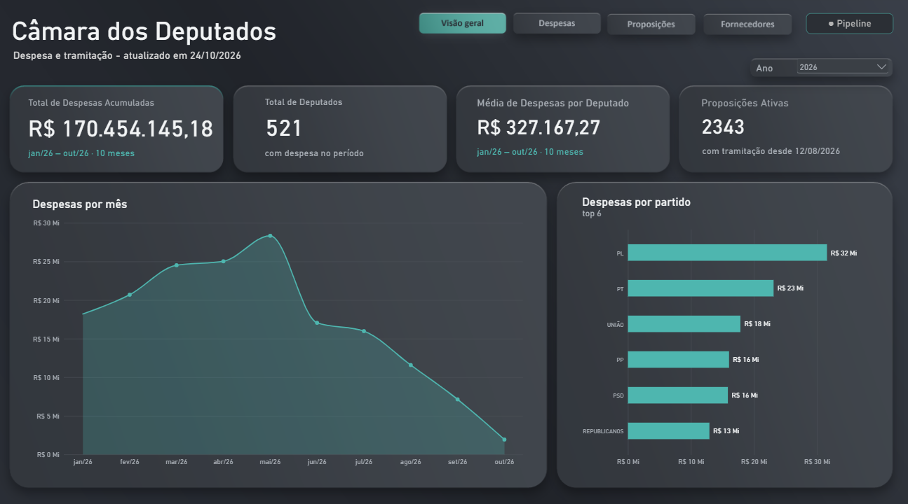
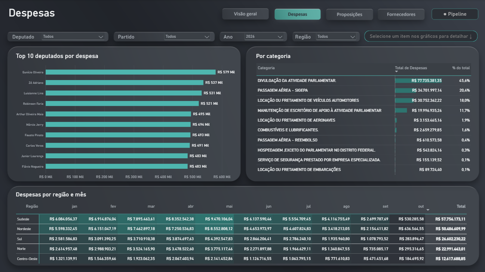
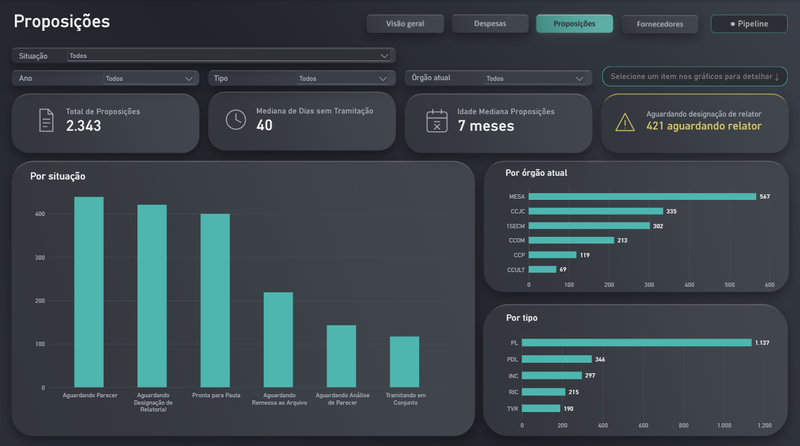
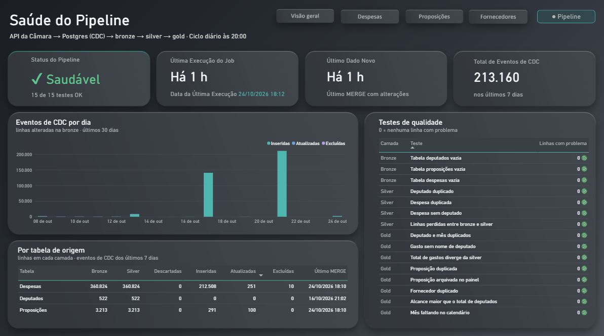
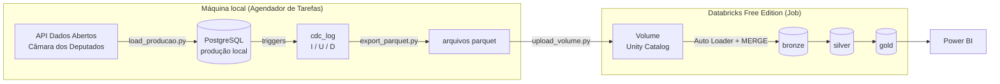
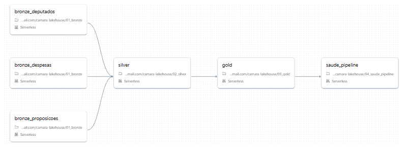
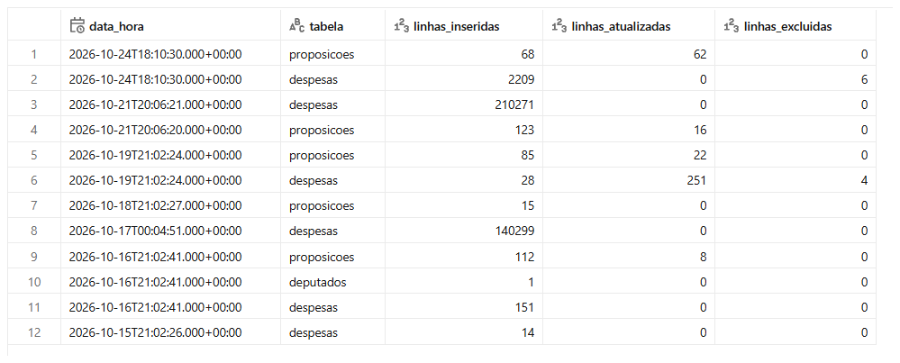
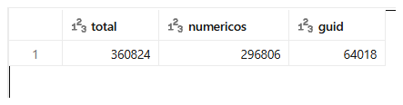
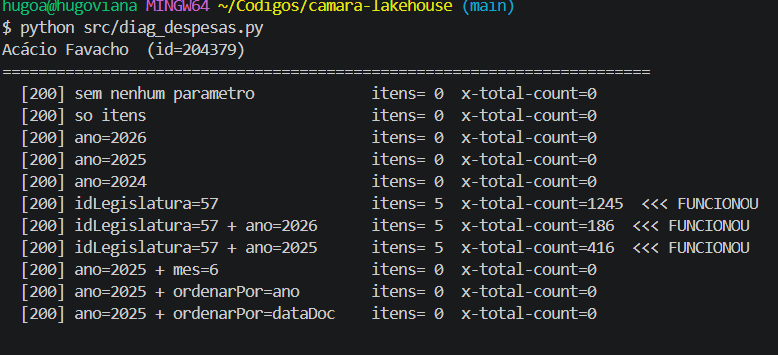

# Lakehouse da Câmara dos Deputados

[](https://app.powerbi.com/view?r=eyJrIjoiMDZjYmIwNjQtZWViNi00Nzg3LWJiNzYtOTkyM2FmYjMzNWY0IiwidCI6IjA4MzBiMGM2LTIzMWItNGVhZS1hZjQ4LWE4MTViZjA2NGM3MyJ9)

**[Abrir o dashboard interativo](https://app.powerbi.com/view?r=eyJrIjoiMDZjYmIwNjQtZWViNi00Nzg3LWJiNzYtOTkyM2FmYjMzNWY0IiwidCI6IjA4MzBiMGM2LTIzMWItNGVhZS1hZjQ4LWE4MTViZjA2NGM3MyJ9)** · [Versão em PDF](docs/camara-dashboard.pdf)

Pipeline incremental que captura as mudanças (CDC) nos dados abertos da Câmara dos Deputados e monta um lakehouse em camadas (bronze, silver e gold) no Databricks, com um dashboard em Power BI no final.

A API da Câmara só entrega o estado atual dos dados, sem histórico de alterações. O ponto central do projeto é descobrir **o que mudou** de um dia para o outro e aplicar só isso no lake.

Em operação desde o fim de agosto de 2026, com execução diária automática. Hoje cobre as despesas da cota parlamentar de 2025 e 2026 (cerca de 360 mil notas, R$ 410 milhões), os deputados em exercício e as proposições em tramitação.

---

## Dashboard

| Visão geral | Despesas |
|---|---|
|  |  |

| Proposições | Saúde do pipeline |
|---|---|
|  |  |

O dashboard completo, com as páginas de detalhamento, está disponível [online e interativo](https://app.powerbi.com/view?r=eyJrIjoiMDZjYmIwNjQtZWViNi00Nzg3LWJiNzYtOTkyM2FmYjMzNWY0IiwidCI6IjA4MzBiMGM2LTIzMWItNGVhZS1hZjQ4LWE4MTViZjA2NGM3MyJ9).

---

## Arquitetura



O pipeline tem duas metades. A coleta roda na minha máquina, porque a Databricks Free Edition restringe o acesso à internet. O processamento roda no Databricks. O Volume do Unity Catalog é o ponto de entrega entre as duas.

O `run_local.sh` faz o ciclo local inteiro e, no fim, dispara o Job do Databricks pela API. Assim o Job sempre roda logo depois que os arquivos chegam, sem depender de dois horários combinados.

| Etapa | Tempo típico |
|---|---|
| Ciclo local (API → Postgres → parquet → Volume) | ~11 min |
| Job no Databricks (bronze → silver → gold → saúde) | ~2,5 min |

As três cargas bronze rodam em paralelo:



---

## Stack

| Camada | Tecnologia |
|---|---|
| Origem | API REST da Câmara dos Deputados |
| "Produção" | PostgreSQL 16 (Docker) com triggers de CDC |
| Coleta | Python · requests · psycopg · pandas · pyarrow |
| Armazenamento | Volume do Unity Catalog (Databricks Free Edition) |
| Processamento | Spark serverless · Delta Lake · Auto Loader |
| Orquestração | Agendador de Tarefas do Windows + Databricks Jobs |
| Visualização | Power BI (modo Import, via SQL Warehouse) |

---

## Fonte de dados

| Tabela | Volume | Como muda |
|---|---|---|
| `deputados` | ~520 | troca de partido, licença, suplente que assume |
| `proposicoes` | ~3 mil | situação, órgão, despacho |
| `despesas` | ~360 mil | notas lançadas, corrigidas e removidas |

Escolhi essas três porque todas têm UPDATE e DELETE de verdade. Com uma fonte só de inserções, o `MERGE` seria um `INSERT` com outro nome.

O endpoint `/proposicoes` aceita `dataInicio` e `dataFim`, que filtram as proposições **que tiveram tramitação** no período. A carga diária usa uma janela de 2 dias.

---

## Como o CDC funciona

Um PostgreSQL local faz o papel do banco de produção. A carga faz `INSERT ... ON CONFLICT DO UPDATE` de tudo o que a API devolve, e as triggers decidem o que virou evento:

- uma trigger `BEFORE` atualiza o `modified_date` e descarta o `UPDATE` que não muda nada;
- uma trigger `AFTER` grava o evento em `producao.cdc_log`, com a operação (`I`, `U`, `D`) e a linha inteira em JSONB.

O log fica no `AFTER` por um detalhe do Postgres: num `INSERT ... ON CONFLICT`, a trigger `BEFORE INSERT` dispara mesmo quando a linha já existe. Na primeira versão o log estava no `BEFORE`, e cada execução gerava um evento `I` falso para cada linha já existente: 513 por dia só de deputados.

O `export_parquet.py` lê os eventos pendentes e grava um parquet por tabela, com timestamp no nome. No Databricks, o Auto Loader lê só os arquivos novos e o `MERGE` aplica as operações:

```python
(self.deltatable.alias("b")
    .merge(df_cdc.alias("d"), f"b.{self.id_field} = d.{self.id_field}")
    .whenMatchedDelete(condition="d.OP = 'D'")
    .whenMatchedUpdateAll(condition="d.OP = 'U'")
    .whenNotMatchedInsertAll(condition="d.OP = 'I' OR d.OP = 'U'")
    .execute())
```

Antes do `MERGE`, cada lote é deduplicado: a mesma chave pode aparecer mais de uma vez no mesmo arquivo, e o `MERGE` do Delta falha se a origem tiver chave repetida. Fica a versão de maior `modified_date`. No evento de exclusão, o `modified_date` é a hora da exclusão, para o `D` sempre vencer.

Cada `MERGE` fica registrado no histórico do Delta com as linhas inseridas, atualizadas e excluídas. O notebook de saúde copia esse histórico para `gold.pipeline_execucoes`:



---

## Decisões técnicas

**Chave das despesas.** O `codDocumento` não é único: quando uma passagem é remarcada ou reembolsada, a Câmara publica outra linha com o mesmo código e valor negativo. Com `codDocumento` como chave, a segunda linha sobrescrevia a primeira e o total ficava errado. A chave é `<codDocumento>#<hash do conteúdo>`, então recarregar não duplica nada. A carga também apaga as linhas que sumiram da API (corrigidas na origem), exceto quando some mais da metade, o que indica uma resposta incompleta.

**Créditos negativos ficam.** A silver não filtra `valor_liquido < 0`. O portal da Câmara soma os créditos, e uma versão anterior que os descartava deixava o total acima do oficial.

**`cod_documento` como texto.** A maioria dos códigos é numérica, mas uma parte vem em formato GUID. CPF e número de documento também ficam como texto, por causa do zero à esquerda.



**Deduplicação sem view temporária.** A referência que inspirou o projeto usa `createOrReplaceGlobalTempView` dentro do `foreachBatch`, o que não funciona no compute serverless (o único da Free Edition). A deduplicação usa `row_number()` sobre uma janela, direto no DataFrame.

**Um schema para os dois lados.** Os arquivos `schemas/*.json` são lidos pelo `export_parquet.py`, para tipar o parquet, e pelo Spark, para ler a stream. A largura do inteiro precisa bater: `Int64` no pandas grava INT64, e um schema Spark com `integer` (INT32) falha com `PARQUET_COLUMN_DATA_TYPE_MISMATCH`.

**`idLegislatura` obrigatório.** Sem esse parâmetro, o endpoint `/deputados/{id}/despesas` ignora o filtro de ano e devolve lista vazia com status `200 OK`. Descobri com o `src/diag_despesas.py`, que testa combinações de parâmetros:



A legislatura é consultada em `/legislaturas`, e não fixada no código.

**Falha da API não derruba o ciclo.** Se a API falha para um deputado ou proposição (já aconteceu um 504 depois de 5 tentativas), o item é registrado no log e a carga segue. Ela só para se mais de 10% falharem. Como a carga é idempotente, quem falhou entra no dia seguinte.

---

## Qualidade e validação

O último notebook do Job (`04_saude_pipeline`) roda 15 testes (tabela vazia, chave duplicada, despesa sem deputado, linhas perdidas entre camadas, total da gold diferente da silver, mês faltando no calendário…) e grava o resultado numa tabela que aparece na página "Saúde do pipeline" do dashboard. Se algum teste falhar, a tarefa termina com erro **depois** de gravar, e o Job aparece como falho (com notificação por e-mail, se configurada).

A mesma página mostra a última execução do Job e o último `MERGE` que mudou alguma linha. As duas datas juntas mostram quando o Job rodou mas não chegou dado novo.

Para conferir os números contra a fonte:

- `src/validar_despesas.py` compara, deputado por deputado, o total da API com o do banco. Em 2025 e 2026 a diferença é R$ 0,00 para todos.
- O total de 2026 no banco é **95,4%** do que o portal da Câmara mostra. O `src/comparar_populacao.py` explica a diferença: o portal soma todos que exerceram o mandato na legislatura, inclusive quem já saiu, e o projeto carrega os deputados em exercício. Somando os 126 que faltam, chega a 99,0%.

---

## Como rodar

Pré-requisitos: Python 3.12+, Docker e uma conta na Databricks Free Edition.

```bash
python -m venv .venv
source .venv/Scripts/activate        # Linux/macOS: source .venv/bin/activate
pip install -r requirements.txt
cp .env.example .env                 # preencher DATABRICKS_HOST, DATABRICKS_TOKEN e DATABRICKS_JOB_ID
docker compose up -d
```

Carga inicial:

```bash
python src/load_producao.py deputados --detalhes
python src/load_producao.py proposicoes --dias 15
python src/load_producao.py despesas --ano 2026 --deputados 0
python src/load_producao.py despesas --ano 2025 --deputados 0
python src/export_parquet.py full
python src/upload_volume.py --schemas
```

No Databricks:

1. Importar a pasta `databricks/` e rodar o `00_setup` uma vez.
2. Criar um Job com as tarefas: `01_bronze` três vezes, em paralelo, uma por tabela (widgets `tablename` e `id_field`; em despesas, `id_field = cod_documento`), depois `02_silver`, `03_gold` e `04_saude_pipeline`.
3. Colocar o ID do Job no `.env`.

Depois disso, o ciclo diário é um comando, que pode ir para o Agendador de Tarefas ou para o cron:

```bash
./run_local.sh
```

---

## Estrutura

```
camara-lakehouse/
├── docker-compose.yml
├── run_local.sh              # ciclo diário
├── sql/01_schema.sql         # tabelas e triggers de CDC
├── schemas/                  # schemas compartilhados com o Spark
├── src/
│   ├── camara_api.py         # cliente da API (retry, paginação)
│   ├── load_producao.py      # API -> Postgres
│   ├── export_parquet.py     # Postgres -> parquet
│   ├── upload_volume.py      # parquet -> Volume
│   ├── disparar_job.py       # dispara o Job no Databricks
│   ├── validar_despesas.py   # API x banco
│   ├── comparar_populacao.py # banco x portal
│   ├── explore_api.py
│   └── diag_despesas.py
├── databricks/
│   ├── 00_setup.py
│   ├── 01_bronze.py
│   ├── 02_silver.py
│   ├── 03_gold.py
│   ├── 04_saude_pipeline.py
│   ├── ingestors.py
│   └── utils.py
├── powerbi/                  # tema e fundos do dashboard
└── docs/
```

---

## Limitações conhecidas

**Proposições só da janela de tramitação.** O projeto só conhece as proposições que tramitaram desde o início da coleta. Uma proposição parada há anos nunca entra. Por isso o dashboard não mostra "paradas há mais de um ano": trazer o histórico completo exigiria uma chamada de detalhe por proposição, dezenas de milhares no total.

**Só deputados em exercício.** Quem saiu do mandato na legislatura não é carregado, o que explica os 4,6% de diferença para o portal em 2026.

**Depende da máquina ligada.** A metade local roda no meu computador. Se ele estiver desligado no horário, o ciclo roda quando for ligado. Nesse meio tempo, o dashboard mostra o pipeline como atrasado.

**CDC por trigger.** Tem custo em cada escrita e não captura operações que ignoram triggers, como `TRUNCATE`. Num banco de produção de verdade, o caminho seria ler o WAL (Debezium).

**Volume gerenciado.** A Free Edition não permite storage próprio. Numa conta paga, a camada raw seria um bucket registrado como External Location, com o resto do código igual.

---

## Próximos passos

- Testes automatizados (pytest) para a chave das despesas e a deduplicação, com CI no GitHub Actions
- Silver e gold em dbt

---

## Créditos

A arquitetura foi inspirada no [lago-mago](https://github.com/TeoMeWhy/lago-mago), do Téo Calvo, adaptada para outra fonte de dados e para as restrições da Databricks Free Edition.

Dados: [API de Dados Abertos da Câmara dos Deputados](https://dadosabertos.camara.leg.br/).

---

Hugo Viana · [LinkedIn](https://www.linkedin.com/in/hugo-viana-hv)
